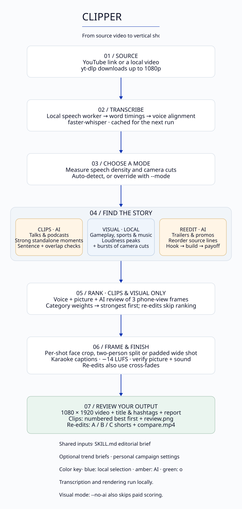
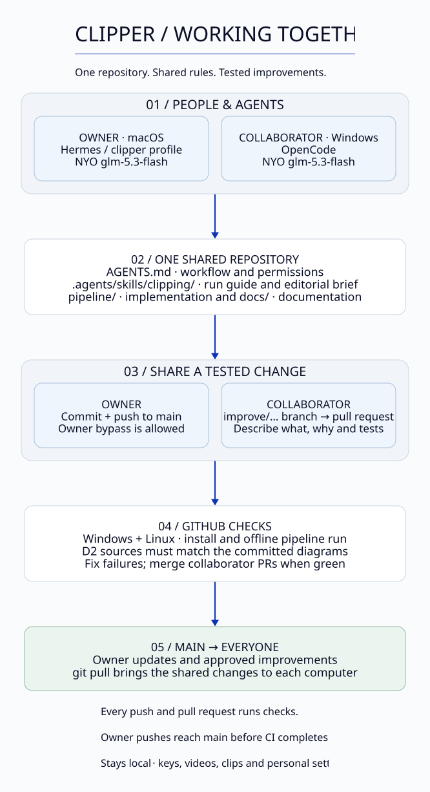

# Architecture

Two diagrams. The pictures are generated from the `.d2` text files next to them, so they're easy to keep current.

## 1. How a video becomes clips

| Colour | Meaning |
|---|---|
| blue | runs on your computer, free |
| amber (hexagon) | an AI step, costs cents |
| green | what you get |
| grey | shared rule files |

The seven stages map to the code:

| Stage | Code |
|---|---|
| 1 · In | `download()` in `pipeline/clips.py` |
| 2 · Listen | `transcribe()`, `refine_timing()` |
| 3 · Understand | `profile()`, `score.category()` |
| 4 · Pick | `pick_hooks()` + `_validate()`, `reedit.py`, `pick_by_energy()` |
| 5 · Rank | `pipeline/score.py` |
| 6 · Make | `frame_filter()`, `captions()`, `render()`, `verify()` |
| 7 · You get | `contact_sheet()`, `post_text()`, the report in `main()` |

## 2. Who runs it, and how improvements travel

Every agent reads the same rules (`AGENTS.md`, `.agents/skills/clipping/`). The owner's agent pushes straight to `main`. A collaborator's agent opens a pull request by itself for tested, general improvements. Every push and pull request runs the Windows + Linux checks.

## Keeping the diagrams current

When a feature, step, mode or flow changes:

1. edit `docs/architecture/pipeline.d2` or `collaboration.d2` (plain text; syntax at https://d2lang.com);
2. run `bash docs/architecture/render.sh` to regenerate the `.svg` files;
3. commit both the `.d2` and the `.svg`.

The `checks` workflow re-renders the diagrams and **fails if an `.svg` doesn't match its `.d2`**, so a forgotten re-render can't slip through.

Install D2 to render: `brew install d2` (macOS), `winget install terrastruct.d2` (Windows), or https://d2lang.com/tour/install. The renderer is pinned to **v0.9.0** so everyone produces identical images.

Why D2: it lays diagrams out automatically with straight right-angle connectors, it's plain text that agents can edit, and the SVG renders on GitHub.
