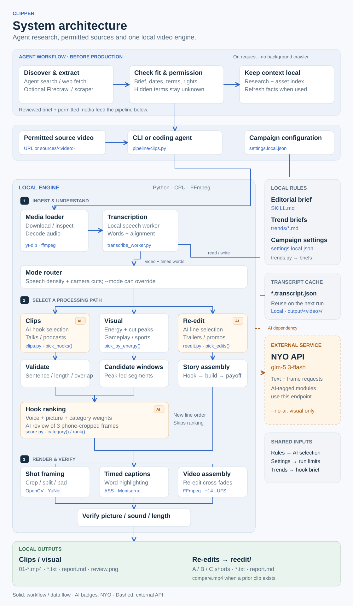

# Architecture

The README showcases the system's components and data paths. Supporting D2 diagrams below explain the pipeline stages and collaboration workflow.

Before the local pipeline, the user's agent can research campaigns and permitted
sources using its connected web tools or an optional external scraper. See
[campaign research](CAMPAIGN-RESEARCH.md) and the collaboration diagram. Discovery
and documentation refresh are agent workflows; this repository does not bundle
a search API, Firecrawl integration or scheduled updater.

## 1. System architecture

The local engine contains ingestion, transcription, three mode paths, rendering and verification. Clips and visual candidates converge at ranking; re-edits assemble a new line order and bypass that scorer. The render row groups shared components rather than implying three independent services.

The top band shows agent-side campaign discovery/extraction, fit and permission
checks, and local research context before production. Its scraper is optional;
it does not imply a built-in Firecrawl integration or a background research job.
Only a reviewed brief and permitted media proceed into the local engine.

The right column separates local support files from the external NYO service. AI badges identify modules that use the shared `_ask()` / `chat()` adapters in `clips.py`; the dashed connector represents that dependency, not a fourth processing path. `--no-ai` skips paid scoring in visual mode. `compare.mp4` is generated only when a prior continuous clip exists.

The SVG has a fixed layout so branch paths, component boundaries and labels stay aligned. Its editable source is `architecture/render-system.py`, which uses Python's standard library. `bash docs/architecture/render.sh` regenerates it along with the D2 diagrams; `--check` validates all three images.
Keep this main graphic, the README alt text, affected supporting diagrams and
implementation descriptions synchronized. Inspect an actual rendered preview:
the freshness check proves reproducibility, not architectural completeness.

## 2. How a video becomes clips

| Colour | Meaning |
|---|---|
| white | shared processing stages |
| blue | local moment selection |
| amber | AI moment selection |
| green | deliverables |

Transcription and rendering run locally. Ranking uses paid AI frame review unless `--no-ai` is set in visual mode. The shared editorial brief, optional trend briefs and personal campaign settings are listed below the flow rather than connected by long arrows.

The seven stages map to the code:

| Stage | Code |
|---|---|
| 1 · Source | `download()` in `pipeline/clips.py` |
| 2 · Transcribe | `transcribe()` → `transcribe_worker.py`, `refine_timing()`; separate native speech/OpenCV processes |
| 3 · Choose a mode | `profile()` (or `--mode`) |
| 4 · Find the story | `pick_hooks()` + `_validate()`, `reedit.py`, `pick_by_energy()` |
| 5 · Rank | `score.category()` and `score.rank()` in `pipeline/score.py`; clips and visual modes only |
| 6 · Frame & finish | `frame_filter()`, `captions()`, `render()`, `verify()` |
| 7 · Review your output | `contact_sheet()`, `post_text()`, the report in `main()` |

Re-edits bypass ranking: they assemble lines into a new story, then render and verify each short. Their outputs live in `output/<video>/reedit/`, including `compare.mp4`; continuous clips get best-first numbering and `review.png`.

## 3. Who runs it, and how improvements travel

Every agent reads the same rules (`AGENTS.md`, `.agents/skills/clipping/`). The owner's agent pushes straight to `main`. A collaborator's agent opens a pull request by itself for tested, general improvements. Every push and pull request runs the Windows + Linux checks. Owner pushes reach `main` before those checks complete; collaborator pull requests are merged after passing checks.

## Additional illustration

The simpler product illustration is preserved on [Visual overview](VISUAL-OVERVIEW.md), with its renderer and design notes. The README uses the system architecture above.

## Keeping the diagrams current

When a feature, step, mode or flow changes:

1. edit `docs/architecture/render-system.py` for the component architecture, or `pipeline.d2` / `collaboration.d2` for the supporting diagrams (D2 syntax at https://d2lang.com);
2. run `bash docs/architecture/render.sh` to regenerate the `.svg` files;
3. commit both the `.d2` and the `.svg`.

The `checks` workflow re-renders the diagrams and **fails if an `.svg` doesn't match its source**, so a forgotten re-render can't slip through.

Install D2 to render: `brew install d2` (macOS), `winget install terrastruct.d2` (Windows), or https://d2lang.com/tour/install. The renderer is pinned to **v0.9.0** so everyone produces identical images.

Why D2: it lays diagrams out automatically with straight right-angle connectors, it's plain text that agents can edit, and the SVG renders on GitHub.
